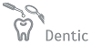
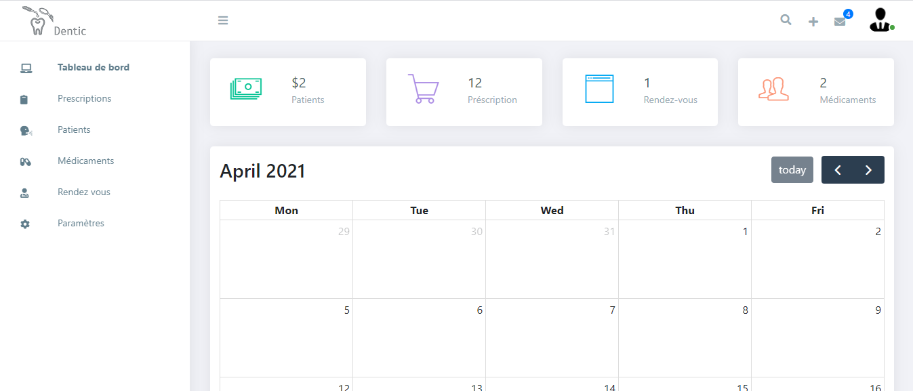

<p align="center">
  
</p>

# Dentic – Dental Care Office Management

Dentic is a comprehensive web application designed to streamline the management of dental care offices. It offers a wide range of features for patient management, appointments, billing, dental imaging, marketing campaigns, and more, all within an intuitive and modern interface.

---

## Table of Contents

- [Introduction](#introduction)
- [Features](#features)
- [Technologies](#technologies)
- [Setup](#setup)
- [Documentation](#documentation)
- [Demo](#demo)
- [Screenshots](#screenshots)
- [Status](#status)
- [Contact](#contact)
- [License](#license)

---

## Introduction

Dentic helps dental professionals manage their clinic efficiently, providing modules for appointments, patient records, prescriptions, billing, staff, doctors, marketing, and dental imaging. The application is built with scalability and usability in mind, supporting multi-user roles and internationalization.

---

## Features

- **Patient Management:** Add, edit, view, and search patient records, including medical history and contact details.
- **Appointment Scheduling:** Book, edit, and manage appointments with calendar integration.
- **Doctor & Staff Management:** Manage profiles, roles, and schedules for clinic staff and doctors.
- **Prescription & Medication Management:** Create and manage prescriptions and medication inventory.
- **Billing & Payments:** Generate invoices, track payments, and manage clinic expenses.
- **Marketing Campaigns:** Create, edit, and track marketing campaigns with target audience selection and performance metrics.
- **Dental Imaging (DICOM Viewer):** Upload, view, and manage dental imaging files for patients.
- **Lab Tests:** Upload and analyze laboratory test results.
- **Telemedicine:** Schedule and manage remote consultations.
- **Reports & Analytics:** View clinic statistics, trends, and summaries.
- **Settings & Configuration:** Customize clinic information, working hours, and system preferences.
- **Internationalization:** Multi-language support for global accessibility.

---

## Technologies

- **Frontend:** React.js, Material-UI
- **Backend:** Spring Boot, Node.js
- **Other:** RESTful APIs, DICOM support, i18n

---

## Setup

1. **Clone the repository:**
   ```bash
   cd DENTIC-FRONTEND-CLIENT
   npm install
   ```
3. **Start the development server:**
   ```bash
   npm start
   ```
4. **Access the application:**
   Open [http://localhost:3000](http://localhost:3000) in your browser.

---


---

## Demo

Try Dentic live: [https://dentic-client.herokuapp.com/](https://dentic-client.herokuapp.com/)

---

## Screenshots

<p align="center">
  
</p>

---

## Status

- **Version:** 1.0
- **Development:** Ongoing
- **Domain:** Medical
- **Created:** October 2020
- **Last Update:** October 2020

---

## Contact

For support or inquiries, email: [contact@delta-dev-software.com](mailto:contact@delta-dev-software.com)

---

## License

This project is licensed under the [MIT License](license.txt)